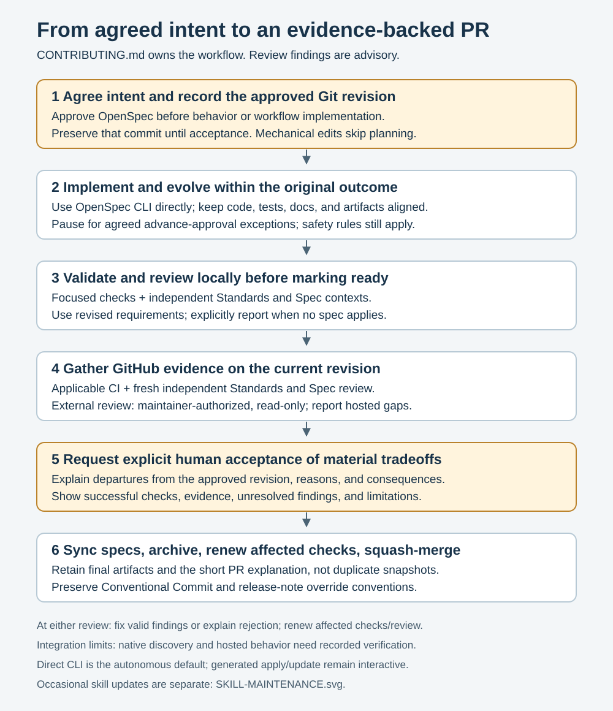

# Contributing to uatu

Thanks for helping improve uatu. This guide is the canonical workflow for
developing, validating, and merging changes. Maintainers should also read
[the release runbook](./docs/RELEASING.md).

## Development setup

Use the Bun version recorded in `package.json` (`packageManager`); CI pins its
runtime in `.github/workflows/ci.yml`. Obtain any required installation or
download approval before running setup commands.

```bash
bun install --frozen-lockfile
bun run e2e:install
bun run dev
```

`bun run dev` starts a dev hub at `http://127.0.0.1:4702/` with
`testdata/watch-docs` registered and opens it. Sign in as `dev` with password
`dev`; [dev/README.md](./dev/README.md) has the details.
[ARCHITECTURE.md](./ARCHITECTURE.md) describes the runtime, state, request,
terminal, and extension points.

`e2e:install` installs Chromium **and WebKit**: the suite includes both engines.
Linux may also need Playwright's system dependencies, as shown in CI.
Committed PR/review skills need no separate installation after clone; see
[agent integration](./docs/agents/integration.md) for discovery checks and limits.

## Changes and branches

1. **Agree intent.** Start a focused branch from an up-to-date `main`. For
   behavior or workflow changes, prepare an OpenSpec change under
   `openspec/changes/<name>/` and obtain approval before implementation. Record
   the Git commit containing the approved artifacts in the handoff or PR;
   verify those artifacts with `git show <approved-sha>:<artifact-path>`. Keep
   that commit available on the work branch until final explicit acceptance;
   do not rebase it away. Recording an existing revision does not authorize a
   commit or publication. Record any change-specific advance-approval
   exceptions with the initial plan; that list may be empty.
2. **Implement and evolve.** Keep code, tests, documentation, requirements, and
   tasks aligned. Within the original outcome, agents may autonomously revise
   approach and make requirement tradeoffs, recording their consequences in the
   working artifacts. Only the explicitly agreed change-specific list of
   advance-approval exceptions requires an earlier pause for these tradeoffs;
   the list may be empty. Changing the original outcome still requires approval,
   and existing safety, permission, installation, and publication rules remain
   controlling. The approved default is [direct OpenSpec CLI use](./docs/agents/integration.md#direct-cli-for-autonomy)
   for status, instructions, and validation, without invoking generated
   apply/update wrappers. Those remain interactive alternatives with their own
   confirmation rules, not the autonomous implementation path.
3. **Validate and review locally.** Run focused checks for affected behavior.
   Before marking any PR ready, run independent Standards and Spec reviews in
   separate contexts, using the [review integration](./docs/agents/review.md).
   Spec review checks revised requirements, not approval-baseline drift; report
   no applicable spec when none exists. Autonomously triage findings, fix valid
   ones or explain rejection, and renew affected checks and reviews after
   material corrections.
4. **Open the PR and verify GitHub evidence.** Use a Conventional Commit title
   and the PR expectations below. Every PR also needs independent Standards and
   Spec review on GitHub; AI findings are advisory, not merge approval. External
   PRs require trusted-maintainer authorization of the current head for read-only
   review. Do not execute candidate tests/scripts/hooks as part of automated
   review. Run tests through applicable CI instead. Resolve findings as above;
   local verdicts are not the GitHub reviewers' conclusions.
5. **Request final acceptance.** Focused local checks and applicable CI must
   succeed before the final acceptance handoff. Report unavailable checks as
   blockers or limitations, never as passes. Explain material departures from
   the approved revision in the PR: what changed, why, consequences, and the
   tradeoffs requiring explicit human acceptance before merge. Passing checks
   and advisory review do not supply that acceptance.
6. **Finish and merge.** After acceptance, sync changed capability specs and
   archive completed planning artifacts before merge; renew affected checks and
   review after final edits. Retain final artifacts and the short PR explanation,
   not a duplicate approved-plan snapshot platform. Squash-merge with a
   Conventional Commit title and successful required checks (`validate` in the
   current CI). Verify the actual target repository's protection settings;
   workflow files alone do not prove a deployed ruleset.

**Mechanical path:** spelling, formatting, or broken-link repairs that change
neither behavior nor workflow need no invented OpenSpec requirements or approval
baseline. Use a focused branch, relevant checks, both review axes locally and on
GitHub (report no applicable spec), and the same PR/merge handoff.



Use the installed project CLI, without a one-off download. For an existing
approved change, the autonomous implementation loop reads:

```bash
openspec_cli=./node_modules/@fission-ai/openspec/bin/openspec.js
change=your-change-name
bun run "$openspec_cli" status --change "$change" --json
bun run "$openspec_cli" instructions apply --change "$change" --json
# Implement approved work, keep artifacts aligned, then repeat status/instructions.
bun run "$openspec_cli" validate "$change" --strict
```

Replace `your-change-name` with the approved change. Read the returned context
files and required project context; honor `blocked` states and missing-artifact
instructions before implementing. This calls the CLI's `instructions apply`
query, **not** a generated apply skill/command. The
[integration reference](./docs/agents/integration.md#direct-cli-for-autonomy)
explains dynamic instructions, advisory guidance, task tracking, and interactive
alternatives. Planning still precedes implementation and requires approval.

The proposal, design, delta specs, and tasks describe intent and acceptance
criteria. Current behavior belongs in `openspec/specs/`; completed planning
artifacts belong in `openspec/changes/archive/`.

Keep each requirement body at or below 500 characters, with detailed cases
in scenarios using `WHEN`/`GIVEN` and `THEN` steps. Move examples and edge
cases into scenarios, or split independent behaviors into separate requirements
without losing their acceptance criteria. OpenSpec 1.14.1 and later report
overlong main-spec and ADDED requirement bodies as warnings, which fail the
repository's strict validation. Headings and scenario text do not count toward
the body limit.

Preserve each clause's scope and strength when moving it: an unconditional
rule must not acquire a narrower scenario trigger, and examples or rationale
must not become new obligations. Express scenario acceptance in concrete
`WHEN`/`THEN` steps rather than leaving prose before or after the steps.
`tests/openspec-discipline.test.ts` checks for newly stranded
scenario prose; semantic preservation still needs a clause-by-clause review.

The generated OpenSpec skills are committed in both `.agents/skills/` and
`.claude/skills/`. When adopting a CLI release, refresh both trees with that
version, retaining the six workflows: propose, explore, apply, update, sync,
and archive. Use skills-only delivery and an isolated `XDG_CONFIG_HOME` with
an explicit custom workflow profile so machine-local settings cannot change
the repository's workflow set. Inspect `openspec update --dry-run --json`
before applying the refresh, then repeat it to confirm no changes remain.

For example, a new terminal interaction follows all six steps, with approved
delta specs, focused terminal tests, and UI evidence. A typo-only correction
uses the mechanical path and link/whitespace checks; its Spec review reports
no applicable requirement rather than creating one.

## Pull requests and commits

Keep the PR readable for someone new to the change: purpose, main changes,
concrete examples or screenshots where useful, checks and results, limitations,
unresolved findings, and merge risk. Include relevant issue/spec links and the
approved revision plus material tradeoff summary when applicable. Resolve issue
references against the **actual target repository**, not an implicit fork.
Link the applicable OpenSpec change/spec or issue. If none applies, state
`No applicable spec: <reason>` so automated review can distinguish absent intent
from missing input; it refuses ambiguous sources rather than guessing.
Agents obtain approval for PR text and draft-versus-ready status before
publication, subject to governing permissions.

Pull requests are squash-merged, so the PR title becomes the commit seen by
Release Please. Titles must follow Conventional Commits:

```text
<type>[optional scope][!]: <description>
```

Examples:

```text
feat(terminal): add searchable session history
fix(review): wrap long base refs in the burden meter
perf(diff): avoid repeated base resolution
chore(deps): refresh the lockfile
ci: pin the release action digest
```

Release behavior:

| Type | Public changelog | Version effect |
| --- | --- | --- |
| `feat` | Features | Minor |
| `fix` | Bug Fixes | Patch |
| `perf` | Performance | Patch |
| Any type with `!` or `BREAKING CHANGE:` | Breaking change | Major |
| `chore`, `ci`, `test`, `build`, `refactor`, `docs` | Hidden by default | None by itself |

Use a user-facing type only when users of the latest stable release need the
change. Public notes describe the stable-to-stable user-visible delta; Git
history can retain the intermediate work that produced it. Routine dependency
updates, including runtime dependency updates, are `chore(deps)`. Only an
update that remediates a known vulnerability is `fix(deps)`, and its summary
should state the security reason rather than only the version bump.

When a separate PR fixes functionality introduced after the latest stable tag,
keep the truthful `fix(...)` PR title and squash commit in Git, but add a
Release Please override to the PR body before merging so the correction does
not appear as a bug stable users experienced:

```text
BEGIN_COMMIT_OVERRIDE
chore(scope): stabilize the unreleased feature before release
END_COMMIT_OVERRIDE
```

This override workflow depends on squash merging. A fix for behavior that does
exist in the latest stable release remains a normal visible `fix(...)` with no
override.

Curate generated release notes through overrides on source PRs, not by editing
the Release Please PR. If an override is added after merge, rerun Release Please
so it rereads the merged PR body. This section owns shared release-note policy;
the maintainer runbook owns publication and recovery.

## Validation

Changes that add or change functionality must include tests — unit tests in
the colocated `*.test.ts` files, plus an e2e test when the behavior is only
observable through the UI.

Run the checks relevant to your change locally; successful applicable CI supplies
the full gate rather than routinely duplicating the entire suite locally. The
available core checks are:

```bash
bun run typecheck
bun run audit
bun run test:ci
bun run check:licenses
bun run build
bun run smoke
bun run test:e2e
./node_modules/.bin/openspec validate --all --strict
```

Choose focused unit files with `bun test <path>` and focused UI checks with
`bun run test:e2e <file>` while iterating. Include a build before `smoke` when
validating the binary. Record exact commands, tool versions, and unrun checks.
For OpenSpec changes validate the selected change strictly, then all artifacts
when preparing the complete handoff; use the locked project CLI, not a fresh
one-off download.

- **API/contract changes:** follow [api/CONVENTIONS.md](./api/CONVENTIONS.md); run `bun run
  api:validate`, relevant `bun run test:api` coverage, and the structural and
  base-relative compatibility checks defined in `.github/workflows/ci.yml`.
  Schema/client changes may also require `bun run api:swift` and site checks;
  these have their own platform/tooling prerequisites.
- **Desktop changes:** follow the path-filtered
  `.github/workflows/desktop-ci.yml`. Its `xcodebuild` build uses the
  `UatuCodeDesktop` project on macOS 26 with the matching SDK; no CLI binary build is required for this
  connect-only client. Report unavailable macOS/Xcode checks explicitly.
- **Managed skill changes:** run `bun run skills:check` and review upstream
  instruction changes as code. See [maintenance](./docs/agents/integration.md#skill-maintenance)
  for the same-PR update path and hosted verification limits.

### Agent SDK coverage

The [Agent SDK coverage dashboard](https://github.com/tjakobsson/uatu/issues/480)
records, for every message type, content-block or part type, and tool the
installed agent SDKs declare, what uatu does with it: dedicated, generic,
ignored, unhandled, or behavior-missing. It is not committed. The `Agent SDK
coverage` workflow (`.github/workflows/agent-coverage.yml`) regenerates it after
every push to `main`, and when a merge adds or removes SDK vocabulary it posts a
comment on the issue naming what changed. An agent SDK bump
(`@anthropic-ai/claude-agent-sdk`, `@anthropic-ai/sdk`, `@opencode-ai/sdk`,
`@opencode/client`) has nothing to regenerate.

To preview what your branch would publish:

```bash
bun run coverage:agents                       # the dashboard body, on stdout
gh issue view 480 --json body --jq .body > /tmp/published.md
bun run coverage:agents --previous /tmp/published.md > /dev/null
                                              # the comment it would post, on stderr
```

`bun test` fails a bump only when uatu itself has to change, never because a
version moved or coverage is incomplete. Only two things are written by hand,
in `src/chat/claude/sdk-coverage.ts` and `src/chat/opencode/sdk-coverage.ts`:
why an ignored type is dropped (every one needs a reason; a key ending in `*`
covers a family), and which entries render without working (and what fixes
them, by name). The generator, and with it `bun test`, rejects an annotation
naming anything the installed SDK does not declare, and an ignored type nobody
has explained — state why, or stop ignoring it so it reports as unhandled.

The full Playwright suite takes longer than unit tests. Focused Playwright
files are appropriate while iterating, but CI remains the final full-suite
gate. Playwright is development-only and is not included in the compiled uatu
binary.

## Releases

Release Please keeps a release PR current from the
Conventional Commits on `main`. Maintainers merge that PR when ready; see
[docs/RELEASING.md](./docs/RELEASING.md) for version/tag ownership, publication,
and recovery steps.
