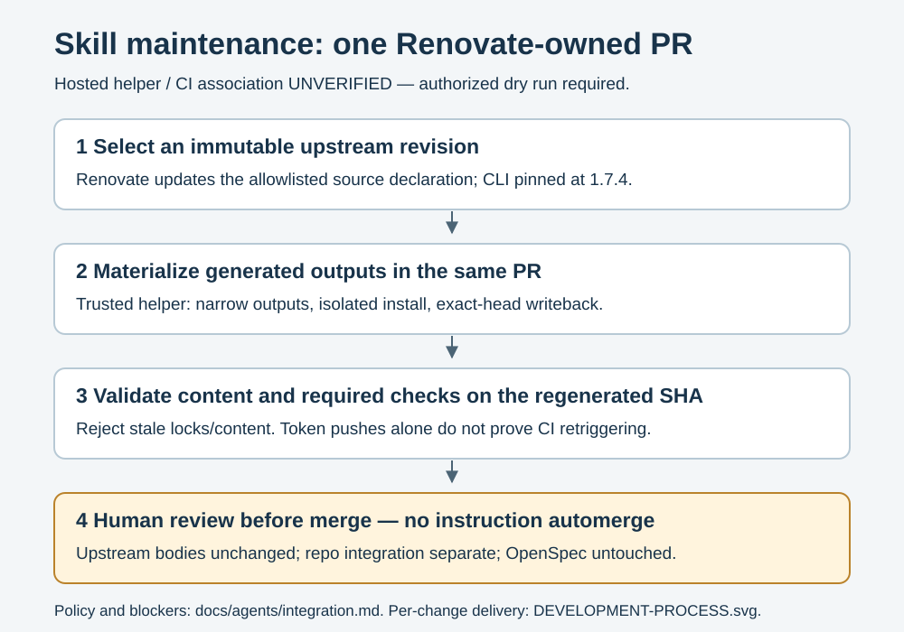

# Agent integration and verification limits

## Native instruction discovery

The supported setup is current Claude Code with native `AGENTS.md` discovery
and OpenCode V2. The migration environment reports Claude Code **2.1.302** and
OpenCode **2.2.2**; these version observations are not clean-clone discovery
tests or minimum-version guarantees. There is deliberately no root `CLAUDE.md`
wrapper. Older clients may need an upgrade, subject to installation approval.

Verify each supported client from a fresh clone without personal/global skills
or ancestor instructions that supply this repository's policy:

1. Record `claude --version` or `opencode --version` and start at the repo root.
2. Use the client's instruction/context inspection to confirm this clone's
   `AGENTS.md` is loaded. Confirm `.agents/skills/pr` and
   `.agents/skills/code-review` are available through native discovery or the
   committed client links. Ask it to identify the concrete paths it loaded;
   merely seeing a global skill with the same name is not sufficient evidence.
3. Repeat from a nested working directory. Check ancestor and local instructions
   and any client instruction overrides; these can alter effective policy.
4. Record the actual loaded paths and client version in the handoff. Treat a
   missing instruction or skill as a support blocker, not permission to add a
   second root policy or modify personal configuration without approval.

End-to-end isolated native-client checks remain pending until these steps are
executed and recorded. The repo-local discovery layout alone proves neither
client's runtime behavior.

## Direct CLI for autonomy

The approved repository default is autonomous implementation through the
existing project-installed OpenSpec CLI: query status and instructions, perform
the authorized work directly, keep artifacts coherent, and validate. Select
this path explicitly rather than invoking generated apply/update skills or
slash commands. It introduces no orchestrator, custom skill, generator fork,
or project schema fork. [CONTRIBUTING.md](../../CONTRIBUTING.md#changes-and-branches)
owns approval boundaries and the short command sequence.

For an existing approved change, `bun run
./node_modules/@fission-ai/openspec/bin/openspec.js instructions apply --change
"<change>" --json` is a read-only CLI query, not the generated apply workflow.
Use the returned data as follows:

1. Read status and apply output, including `planningHome`, `changeRoot`,
   `contextFiles`, tasks, progress, and the dynamic `instruction`. Read all
   returned context files and apply required project `context`.
2. Honor CLI-controlled state. For `blocked`, resolve the reported missing
   artifacts/tracking evidence within existing authority, or report the blocker;
   rerun the query before implementation. A `ready` result is not human plan
   approval. `all_done` reflects tracked tasks, not proof that checks, review,
   or final acceptance have occurred.
3. Follow applicable dynamic instructions. `operationGuidance` is advisory and
   additive; neither it nor project context replaces controlling instructions,
   safety rules, explicit user choices, or CLI state. Surface actual conflicts
   instead of silently treating them as authority to bypass a gate.
4. Implement within the authorized outcome, update working artifacts and each
   completed task at its reported source path/line, then refresh status and
   instructions. Confirm the task still matches before editing its checkbox;
   mark it complete only when its specified behavior is delivered. Validate the
   selected change strictly and run the checks/reviews required by CONTRIBUTING.

Generated integrations remain available as **interactive alternatives**. Choose
them when their per-edit confirmation/pause behavior is wanted; once invoked,
their rules remain controlling. Direct CLI use is the approved invocation
choice, not a claim that root policy overrides a loaded generated workflow.

## Generated OpenSpec prompts

OpenSpec owns the six generated workflows in `.agents/skills/openspec-*/` and
`.claude/skills/openspec-*/`: propose, explore, apply, update, sync, and archive.
Their committed metadata records **1.17.0**, matching the merged package pin.
The old `.opencode/` OpenSpec skills/commands and `.claude/commands/opsx/`
commands are no longer the generated delivery paths. Other client links are
not OpenSpec outputs. Preserve generated files; use supported CLI mechanisms
with authority for any refresh, following
[CONTRIBUTING.md](../../CONTRIBUTING.md#changes-and-branches): isolated
`XDG_CONFIG_HOME`, an explicit custom profile selecting those six workflows,
and skills-only delivery. Inspect `openspec update --dry-run --json` before
refreshing and repeat it afterward to check for remaining changes. These are
the merged maintenance conventions, not a refresh executed in this task.

The generated workflows retain rules incompatible with the default autonomous
path; this is why that path uses the CLI directly:

- Both trees' `openspec-apply-change/SKILL.md`, step 6 and Guardrails,
  require pausing when implementation suggests artifact updates or dropping,
  narrowing, deferring, or accepting exceptions to specified behavior.
- Step 3 explicitly makes `context` and `operationGuidance` additive inputs:
  they cannot replace the built-in instruction or bypass CLI state. Thus adding
  project guidance in `openspec/config.yaml` is not a demonstrated override.
- The update workflow edits planning artifacts only, and points back to apply
  for implementation. Its step 5 also requires showing each proposed revision
  and writing only after confirmation; its Guardrails say to confirm every
  edit. Broad prior authorization for autonomous evolution has no documented
  exception to that sequence. Proposal's planning-only boundary remains
  compatible with obtaining approval before implementation.

Historical regeneration with the then-installed **1.14.0** CLI was tested in isolated scratch
using `openspec init <scratch-project> --tools claude,opencode --profile core
--no-animation`, followed by `openspec update <scratch-project> --force`.
Both clients' regenerated apply and update skills/commands retained these rules.
That experiment concerned the previous generated layout; it does not validate
1.17.0 regeneration or runtime behavior. Inspection of the committed
1.17.0-generated apply/update skills in both current trees confirms that their
pause/per-artifact confirmation rules remain present.

Supported project-local schemas (`openspec schema fork`, then
`openspec/schemas/<name>/schema.yaml`) can change the artifact graph and dynamic
`apply.instruction`, not the generated workflow's pause/confirmation rules.
Project configuration supplies required `context`, additive artifact `rules`,
and advisory `operations.apply.guidance` / `operations.archive.guidance`; there
is no supported update-operation override in the inspected 1.14.0 implementation.
In that version, workflow profile selection controls which static templates are
generated, not their rules, and `openspec config` supports global scope only.
No compatible configuration override was found in that 1.14.0 source or CLI
help; this is not an exhaustive claim about 1.17.0 configuration support.

The upstream merge pins **1.17.0**. After recovering from an `ENOSPC` restore
failure, the approved frozen install with isolated Bun **1.4.4** succeeded.
Project-local status/apply-instructions queries and strict validation passed
for this change and all 61 current spec/change items; TypeScript, skill
consistency, and the installed-package license audit also passed. This verifies
the direct CLI path, not 1.17.0 regeneration or native-client discovery. The
global **1.12.0** CLI is not a substitute for the locked project CLI. The
committed skills also describe
`--store <id>` selection when targeting a registered store and a read-only
`list --json` project-root check before writes. The repository examples above
target this existing local `openspec/` root; they do not establish untested
1.17.0 store or runtime behavior.

The approved decision is **Direct CLI for autonomy** as the repository default.
The mandatory-pause behavior therefore remains an
interactive-wrapper limitation, not an unresolved choice of implementation
path. Preserve generated files unchanged. If a generated workflow is selected,
honor its constraints; neither this decision nor root guidance rewrites them.

## Skill maintenance

Only Matt Pocock's `pr` and `code-review` are managed upstream imports here.
Keep their source, required companions/attribution, immutable revision, and
project lock consistent. The exact skills CLI is pinned at **1.7.4**; inspect
the manifest, source declaration, and lock for installation inputs rather than
using an unqualified latest/bulk update. Repo adaptations belong in
[review.md](review.md), outside imported files.

Use `bun run skills:check` for consistency and `bun run skills:update` to
materialize the selected source revision after obtaining required download
authority. These helpers must leave OpenSpec-generated content untouched.
Review the resulting instructions before merge; skill updates are not automerged.

Renovate owns the update PR. A narrowly scoped same-PR helper is intended to
refresh generated skills/lock from trusted base code, reject unauthorized or
stale candidates, and trigger CI for the regenerated head. Hosted update PR
creation, push/dispatch, required-check association, and external-review authorization
remain **unverified** until an authorized dry run demonstrates them on the
actual target repository. A token push or successful workflow dispatch alone
does not prove the required PR checks attach to the new SHA. Report blockers;
do not change credentials or live services implicitly to make automation work.

Privileged workflows check out fixed `main`, never an event-payload ref. The
skill helper records that checkout's actual SHA and requires the PR base and
generated payload to match it; if `main` advances between jobs it fails closed
and needs regeneration, rather than executing candidate or mismatched policy.

### CI verification of Renovate configuration

The path-filtered `Validate Renovate` workflow also supports manual dispatch.
It installs official Renovate **44.199.2** under runner temporary storage with
Node **24.22.2**, no lifecycle scripts or optional dependencies. It validates
`renovate.json` with `--strict --no-global`, then runs the experimental
[local platform](https://docs.renovatebot.com/modules/platform/local/) with
`--dry-run=extract` against only copied configuration and `skills-source.json`.
No token, repository scripts, or hosted writes are used by Renovate. Missing
optional RE2 means Renovate uses its JavaScript regex fallback; this does not
certify native RE2 compatibility.

The check asserts and prints the official extraction record: `mattpocock/skills`,
`main`, `git-refs`, and the exact committed digest. Separate Bun fixtures cover
regex replacement and the evidence assertions. Extraction does **not** prove
datasource lookup, Renovate-generated digest replacement, hosted PR creation,
writeback, or required-check association. Record the actual run URL and tested
SHA before reporting a CI pass; the workflow's presence is not a successful run.

