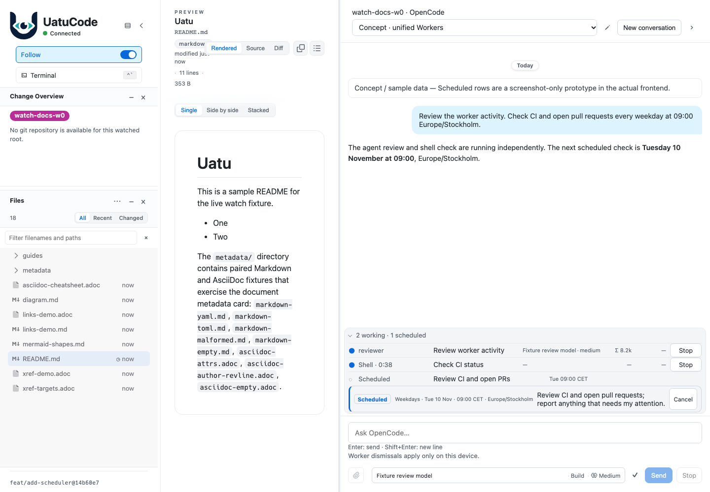
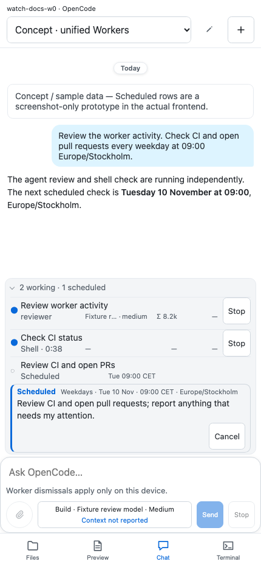

# Unified Workers concepts in the actual frontend

These screenshots load **Uatu's real frontend** through its existing E2E server:
`src/index.html`, the app bundle, production stylesheet, bundled fonts, native
worker renderer, and steer-card renderer. They are not renders of the earlier
standalone mock HTML.

**The scheduled row is still a fixture-only presentation prototype, not an
implemented scheduler integration.** The conversation title and transcript label
the sample state in the actual UI.

## What is real, and what is simulated

- The application shell, preview, chat, composer, responsive layout, themes, and
  existing agent/shell worker rows are rendered by the real frontend.
- The steer card is obtained by submitting scripted input to the existing fake
  OpenCode V2 backend and capturing the real `QueueDockRenderer` output. That
  pending input is reset away before the screenshots.
- A test-only helper clones native worker/card markup, changes its sample labels,
  and places one proposed **Scheduled** row in the existing Workers list. It
  adjusts the displayed count and scheduled-only visibility for the demonstration.
- The proposed row borrows the incumbent non-working/unknown layout styling;
  that is a CSS reuse technique, **not** a provider-reported unknown task state.
  The only explicit layout property is a grid-column span. No replacement theme,
  typography, global stylesheet, standalone app shell, or product renderer is added.
- Cancellation states and firing are scripted samples. Cancel makes no native
  scheduling or pending-message request. Pause, resume, and editing remain chat
  interactions in the proposed initial scope.
- The ordinary rows are the existing agent and shell kinds. No unsupported image
  worker kind, new inspection view, or separate Schedules/Pending panel is invented.
- Model names, token counts, worker durations, CI status, and pull-request results
  are scripted sample data, not provider benchmarks or real account activity.

## Desktop and mobile gallery

| State | Desktop | Mobile |
| --- | --- | --- |
| Compact summary | [01](01-compact-desktop-light.png) | [02](02-compact-mobile-light.png) |
| One mixed Workers list | [03](03-list-desktop-light.png) | [04](04-list-mobile-light.png) |
| Native steer-card styling, expanded inline | [05](05-expanded-desktop-light.png) | [06](06-expanded-mobile-light.png) |
| Cancellation awaiting confirmation | [07](07-cancelling-desktop-dark.png) | [08](08-cancelling-mobile-dark.png) |
| Cancellation outcome unconfirmed | [09](09-unconfirmed-desktop-dark.png) | [10](10-unconfirmed-mobile-dark.png) |
| Confirmed cancellation; row removed | [11](11-cancelled-desktop-light.png) | [12](12-cancelled-mobile-light.png) |
| Recurring follow-up; next due time advances | [13](13-fired-desktop-light.png) | [14](14-fired-mobile-light.png) |
| Only scheduled work remains | [15](15-scheduled-only-desktop-light.png) | [16](16-scheduled-only-mobile-light.png) |





Desktop captures are 1440 × 1000 CSS pixels; mobile captures are 430 × 932.
The desktop uses the existing chat-panel width preference, not a new layout.
Mobile captures use the frontend's actual touch UI. They are Chromium captures,
not physical-device validation.

## Reproduction

Use the locked dependencies and Bun 1.4.4 on `PATH`, plus an already installed
Playwright Chromium browser:

```sh
UATU_CAPTURE_UNIFIED_WORKERS=1 UATU_E2E_PRIMARY_AGENT_NAME=OpenCode \
  bun run test:e2e tests/e2e/chat-unified-workers-screenshots.e2e.ts \
  --project=e2e --workers=1 --retries=0 --reporter=line
```

Tests capture into Playwright's output directory and evidence attachments; they
do not write this documentation folder. The final PNGs are assembled here after
review. Each scenario resets the scripted backend. There are no live providers,
paid model requests, real schedules, or user-account changes.

Source:
- [Capture suite](../../../tests/e2e/chat-unified-workers-screenshots.e2e.ts)
- [Fixture-only augmentation](../../../tests/e2e/unified-workers-screenshot-fixture.ts)
- [Capture manifest](capture-manifest.json)

The earlier [unified static concepts](../opencode-background-unified/README.md)
remain unchanged for comparison. Use this gallery to judge the real frontend's
look, while treating scheduler behavior and provider compatibility as unimplemented.

## Verification

- Existing Chromium worker interaction regression: **1 passed**.
- Final opt-in capture run: **2 passed**, 16 screenshots, one worker, zero retries.
- Strict TypeScript check of the new capture suite/helper: passed.
- Capture assertions cover one worker list, empty Pending/hidden old wakeup panel,
  retained prototype rows/counts, no page-script errors or horizontal overflow,
  and visible Cancel targets above the composer with at least 44px touch height.
- Independent source/visual review accepted the corrected real-frontend captures
  with fixture-only prototype scope. It did not establish native scheduler support.

Fixture-router resets emitted loopback-upstream disconnect warnings in the test
log; the capture assertions completed successfully. This is not a full product,
native-provider, physical-device, or screen-reader acceptance run.
