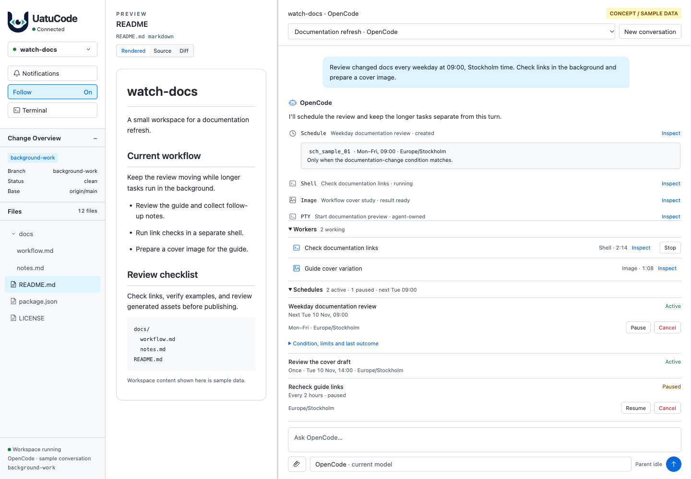

# Chat-first background-work concepts

**Static UI proposals with sample data—not implemented features.** This second
set minimizes redesign and preserves the [first concepts](../opencode-background-concepts/README.md)
for comparison.

## The interaction model

- **Chat remains the main surface.** No new feature tabs or management pages.
  Desktop keeps the workspace files, document preview, and conversation together.
- **The timeline explains what happened.** Scheduling calls, shell launches,
  terminal tools, image results, and scheduled follow-ups stay in the conversation.
- **Workers shows work that still needs tracking.** Native job inventory improves
  the existing summary/recovery rather than creating a separate Jobs browser.
- **The existing wakeup panel shows future schedules.** Add native pause/resume
  and cancellation, with timing, conditions, limits, and last-check details behind
  disclosure. Future schedules are not counted as working jobs.
- **Inspection supplies detail.** Shell output, an image result, or read-only
  agent-terminal output opens through familiar inspection and Back interactions.
  Uatu's own Terminal remains a separate, unchanged surface.
- **Creation stays conversational.** Ask OpenCode to schedule work or run a
  command. There is no new creation form or wait-for-idle button.

## Screenshot gallery

| Screenshot | What changes inside the existing chat |
| --- | --- |
| [Chat overview · desktop, light](01-chat-overview-desktop-light.png) | Timeline plus compact Workers and Schedules panels above the composer. |
| [Schedule details · desktop, light](02-schedule-details-desktop-light.png) | Progressive disclosure for native timing, conditions, limits, and the last check—not a management screen. |
| [Shell inspection · desktop, dark](03-shell-inspection-desktop-dark.png) | Familiar inspection strip, captured output, Back, and scoped Stop. |
| [Image inspection · desktop, light](04-image-inspection-desktop-light.png) | A background image result inspected from its conversation context. Artwork is a synthetic geometric sample. |
| [Agent-terminal inspection · desktop, dark](05-agent-terminal-inspection-desktop-dark.png) | Read-only agent-owned terminal output, not a replacement for Uatu's Terminal. |
| [Scheduled follow-up · desktop, light](06-scheduled-followup-desktop-light.png) | A wakeup attributed to its schedule rather than displayed as user-typed input. |
| [Chat overview · mobile, light](07-chat-overview-mobile-light.png) | Compact summaries and schedule controls within the existing chat surface. |
| [Shell inspection · mobile, dark](08-shell-inspection-mobile-dark.png) | The same inspection interaction adapted to a narrow viewport. |

## Scope and technical limits

These are illustrative layouts, not acceptance of an implementation design.
The [research note](../../dev/opencode-scheduling-background-research.md) owns the
upstream capability findings and uncertainties.

- OpenCode schedule cancellation would remove the native schedule. It must not
  reuse Claude's process-release behavior or imply the two pause meanings match.
- Schedule-to-turn attribution needs native evidence. The follow-up screenshot
  illustrates the desired presentation, not proof that all required evidence is
  already exposed by the provider.
- Job inventory alone does not grant Stop authority or establish a final result.
  Missing provider metadata should stay missing, not become invented percentages,
  token counts, costs, or execution guarantees.
- The minimal terminal concept is read-only. Interactive takeover/handoff is
  deferred until its authorization and ownership protocol is established.
- Workspace/server shutdown and schedule restart recovery remain unverified.
  These concepts do not introduce an always-on Uatu scheduler.

## Source and provenance

Open [prototype.html](prototype.html) in a browser. It is isolated from production
routes, makes no live OpenCode calls, and requires no dependency installation.
Prototype interactions affect sample state only.

Select `view=overview|schedule-details|shell-inspection|image-inspection|terminal-inspection|wakeup`
and `theme=light|dark` in the URL. `capture=1` hides only the prototype switcher;
the concept/sample-data label stays visible.

[capture-manifest.json](capture-manifest.json) records the exact viewport sizes,
source and image hashes, and browser-capture provenance. The screenshots are
browser renders, not AI-generated images or physical-device captures. Mobile
panes scroll; screenshots show their visible viewport rather than all history.
Desktop captures are 1440 × 1000 CSS pixels, except the expanded schedule-detail
capture at 1440 × 1200. Mobile captures are 430 × 932.

No production code, agent settings, dependencies, or files in the original
concept gallery are changed for this set.

## Verification and review limits

All eight final images were visually reviewed at static-concept scope. The
schedule-detail capture was made taller to show the trailing controls in full.
The browser checks found no page-script errors or document-level horizontal
overflow, and confirmed that the logo and bundled font loaded. Every desktop
state retained the document preview; the two mobile states kept Workers and
Schedules collapsed initially. The original gallery was verified byte-for-byte
unchanged.

The mechanical style check retained warnings about the incumbent Inter stack
and 11px metadata rather than redesigning the typography. These mockups are not
production accessibility, live-provider, physical-device, or full product-test
acceptance. Mobile history/output and the dock remain scrollable.
The temporary loopback capture server was stopped after verification.
