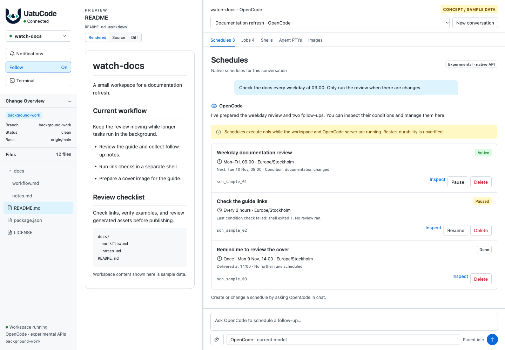
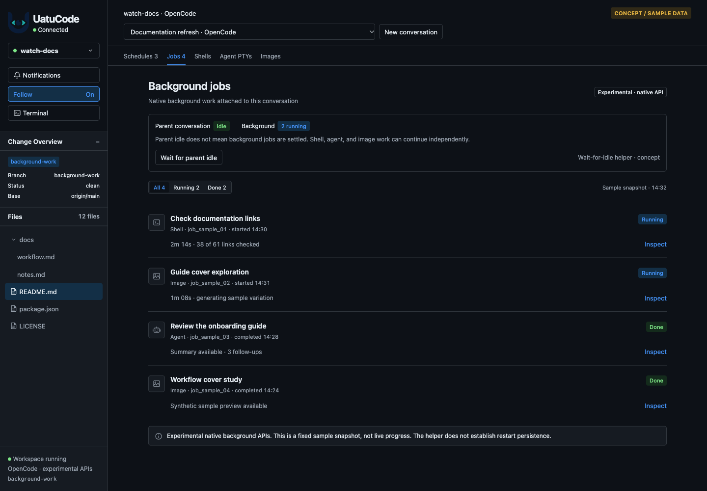

# OpenCode background-work UI concepts

**Design mockups, not implemented Uatu features or live-provider evidence.**
All conversations, schedules, commands, terminal output, job states, and artwork
are illustrative sample data. Native capabilities and integration gaps are
described in the [research note](../../dev/opencode-scheduling-background-research.md).

These concepts extend Uatu's existing chat/workspace styling rather than propose
a redesign. The scope includes the larger, less-defined terminal and image-job
features as well as the recommended initial schedule support.

## Screenshot gallery

| Screenshot | Proposed behavior |
| --- | --- |
| [Schedules · desktop, light](01-schedules-desktop-light.png) | Conversation-scoped schedule inventory, next due time, timezone, and separate pause/resume/delete actions. |
| [Schedule details · desktop, light](02-schedule-detail-desktop-light.png) | Conditional checks, lifetime limits, and diagnostics; a failed check is not a failed agent turn. |
| [Background jobs · desktop, dark](03-background-jobs-desktop-dark.png) | Native job inventory with agent, shell, and image jobs; parent-idle status remains distinct from background completion. |
| [Shell commands · desktop, dark](04-shells-desktop-dark.png) | Native command browser, captured output, and a hypothetical guarded command-launch affordance. |
| [Agent terminals · desktop, dark](05-agent-terminals-desktop-dark.png) | Agent-owned terminals, read-only inspection, and explicitly separate control ownership. This is not Uatu's existing terminal. |
| [Image jobs · desktop, light](06-image-jobs-desktop-light.png) | Image-job status and an illustrative result preview; the sample artwork was not generated by a model. |
| [Schedules · mobile, light](07-schedules-mobile-light.png) | Schedule controls adapted to a narrow chat viewport. |
| [Background jobs · mobile, dark](08-background-jobs-mobile-dark.png) | Compact native job inventory and parent-idle distinction. |

### Schedules

### Background jobs

## Scope and open decisions

- Schedule creation can remain agent-driven initially. The concepts do not
  require a second scheduling engine in Uatu.
- An OpenCode schedule's native pause is not Claude's process-retirement pause.
  Deleting a schedule is not equivalent to releasing a session.
- Schedule persistence and behavior after workspace/server shutdown remain
  unverified. No always-on guarantee is proposed.
- Job inventory alone must not grant Stop authority or replace the existing
  proven worker-occurrence identities.
- Image result/assets and interactive terminal ownership still need technical
  investigation; their layouts are proposals, not accepted contracts.
- A wait-for-idle control is an illustrative way to expose the helper, not a
  requirement to add a new button. It concerns the parent loop, not detached jobs.
- Unrestricted synthetic-input injection and full native inbox administration
  are intentionally outside these concepts.

## Source and reproduction

Open [prototype.html](prototype.html) in a browser. It is an isolated static
prototype, outside product routes, with no dependency installation or live
OpenCode connection required. Any interactive controls affect sample state only.

The `view` query parameter selects `schedules`, `schedule-detail`, `jobs`,
`shells`, `terminals`, or `images`; `theme=light|dark` selects the theme.
`capture=1` hides prototype-only navigation, not the concept/sample-data label.

The PNGs are browser captures of that HTML, not AI-generated screenshots.
[capture-manifest.json](capture-manifest.json) records their source, viewports,
and provenance. Desktop captures are 1440 CSS pixels wide, with 1000- or
1200-pixel heights to include the details being illustrated; mobile captures
use 430 × 932 CSS pixels. Mobile panes scroll, so their images show the visible
viewport rather than the entire inventory. These are not physical-device
screenshots.

Only documentation/mockup files are added. No agent configuration, product
behavior, dependencies, or live schedules are changed.

## Verification and limits

The final eight captures had no page-script errors or document-level horizontal
overflow; the logo and bundled monospace font loaded before capture. PNG
dimensions, checksums, embedded origins, source hash, gallery links, and script
syntax were checked. Independent visual review accepted the corrected set at
static-concept scope, not as production acceptance.

The dark logo remains less distinct than Uatu's production inline-SVG retint.
Mobile controls below the initial viewport require scrolling. These are known
mockup limitations, not changes to the product's accessibility or layout rules.
No live-provider, physical-device, screen-reader, or full product test suite was
run. The temporary loopback capture server was stopped after capture.
