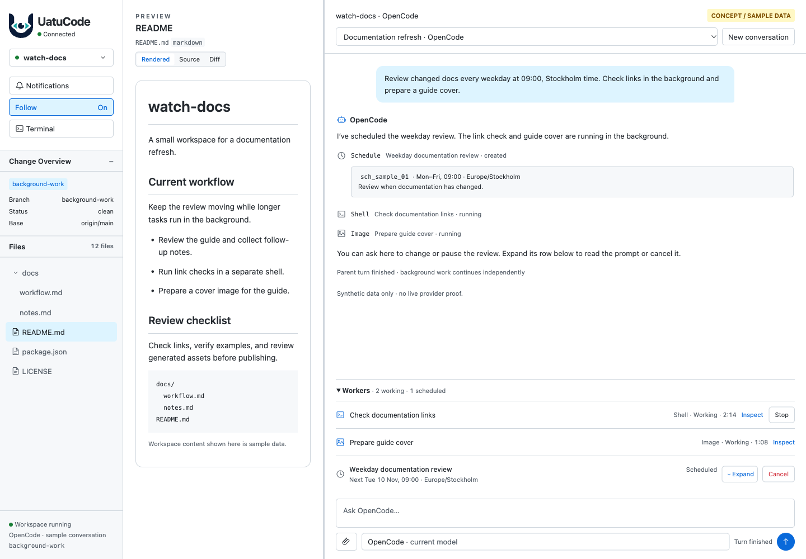
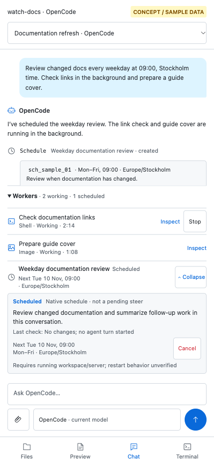

# One Workers list: desktop and mobile concepts

**Static mockups with sample data—not implemented features.** This set follows
the clarified minimal scope: scheduled prompts are another row type in the
existing Workers/background-task list. No additional Schedules or Pending panel,
feature tab, management screen, or inspection screen is introduced. Existing
steer/queue UI is unchanged; these samples contain no pending user messages.

The two previous explorations remain unchanged:
[initial concepts](../opencode-background-concepts/README.md) and
[chat-first concepts](../opencode-background-chat-first/README.md).

## What would change

1. The existing summary adds a scheduled count: **2 working · 1 scheduled**.
2. The same flat list contains ordinary worker rows and a **Scheduled** row with
   its next due time. Future prompts never count as working.
3. Expanding the scheduled row reuses the compact **steer-card presentation**:
   prompt, timing, timezone, and Cancel. It does not create an actual steer.
4. Cancellation feedback stays attached to that row. Pending or unconfirmed
   cancellation does not optimistically remove the schedule or reduce its count.
5. Confirmed cancellation removes the row; the summary omits the zero category.
6. A recurring schedule that fires can start a clearly attributed follow-up in
   the existing transcript, while its row advances to the next due time.

Creation, editing, pause, and resume remain conversational in this initial
scope. Existing worker Inspect/Stop interactions remain unchanged. There is no
new shell launcher, image gallery, agent-terminal interface, or wait-idle button.

## All changed states, on both sizes

These are scenarios of **one chat surface**, not separate product views.

| State | Desktop | Mobile |
| --- | --- | --- |
| Compact summary | [01](01-compact-desktop-light.png) | [02](02-compact-mobile-light.png) |
| One expanded mixed list | [03](03-mixed-list-desktop-light.png) | [04](04-mixed-list-mobile-light.png) |
| Scheduled row expanded using steer styling | [05](05-scheduled-expanded-desktop-light.png) | [06](06-scheduled-expanded-mobile-light.png) |
| Cancellation awaiting confirmation | [07](07-cancelling-desktop-dark.png) | [08](08-cancelling-mobile-dark.png) |
| Cancellation outcome unconfirmed | [09](09-unconfirmed-desktop-dark.png) | [10](10-unconfirmed-mobile-dark.png) |
| Cancellation confirmed; row removed | [11](11-cancelled-desktop-light.png) | [12](12-cancelled-mobile-light.png) |
| Recurring schedule fires; next due time advances | [13](13-fired-desktop-light.png) | [14](14-fired-mobile-light.png) |
| Only a future schedule remains; nothing is working | [15](15-scheduled-only-desktop-light.png) | [16](16-scheduled-only-mobile-light.png) |

### One list, not another panel

### Scheduled row expanded on mobile

## Behavior and limits

- Compact mobile is the initial collapsed state. Expanded images represent a
  deliberate disclosure, not new automatic mobile expansion.
- The Cancel action concerns a native schedule ID. It is not worker Stop,
  pending-message withdrawal, or Claude's Release session behavior.
- The expanded card borrows steer styling only. Schedule state, attribution, and
  authorization remain distinct internally.
- Unconfirmed cancellation may still allow a fire. The mockup does not imply a
  safe automatic retry or guaranteed cancellation.
- Follow-up attribution and next-due values require native evidence. The images
  illustrate the intended presentation, not proof of provider compatibility.
- Schedule persistence after workspace/server shutdown remains unverified.
  There is no second timer engine or always-on scheduling promise.
- Native job inventory may help populate the existing list, but does not itself
  grant worker-control authority or prove a final result.

The [research note](../../dev/opencode-scheduling-background-research.md) records
the underlying API findings and uncertainties.

## Source and provenance

Open [prototype.html](prototype.html) in a browser. This isolated prototype makes
no live OpenCode calls and needs no dependency installation. Controls only
simulate sample state.

The URL selects `state=compact|list|expanded|cancelling|unconfirmed|cancelled|fired|scheduled-only`
and `theme=light|dark`. `capture=1` hides prototype-only controls while retaining
the concept/sample-data label.

[capture-manifest.json](capture-manifest.json) records viewport sizes, source and
image hashes, and browser-capture provenance. The PNGs are browser renders, not
image-model output or physical-device captures. Internal panes can scroll;
screenshots show the selected viewport rather than the whole transcript.

No production UI, agent configuration, dependencies, or previous gallery files
are changed by this exploration.

Desktop captures are 1440 × 1000 CSS pixels and mobile captures are 430 × 932.
The visible Cancel targets are 44px high on mobile. Browser checks confirmed one
work summary and one flat work list in every scenario, no separate schedule
panel, no page-script errors or horizontal document overflow, and loaded local
logo/font assets. They also checked the expanded fired-state detail against its
follow-up and next due time.

The style detector retained warnings for the incumbent Inter stack and 11px
metadata, rather than changing the design system. These captures are not live
provider, production accessibility, physical-device, or full product-test
acceptance.

Independent visual review accepted the corrected set at static-concept scope.
Source/image hashes, PNG checksums and embedded origins, gallery links, and
preservation of both previous galleries were verified. The temporary loopback
capture server was stopped after verification.
